# Mobility-suit simulator — M7 evaluation report

## 1. Executive summary

Simulation of a thruster-based wearable mobility suit (91 kg human + 9 kg suit, 2 lift pods, 2 fans, 40 micro-jets, 3 airbags) in MuJoCo, with a sensor-only state estimator, a constrained thrust allocator, model-based controllers for the three tasks and a residual PPO policy for T1. Every number below comes from fully randomised episodes (human mass ±10 %, thrust ±15 %, thruster lag ±50 %, sensor noise ×0.5–2, ground friction 0.5–1.0) evaluated with fixed seeds; rates carry Wilson 95 % intervals.

| task | evaluation | episodes | metric | result (95 % Wilson CI) | target | pass |
|---|---|---|---|---|---|---|
| T1 | T1 drop — baseline | 1000 | safe landing | 99.5 % [98.8, 99.8] (995/1000) | ≥ 95 % | **PASS** |
| T1 | T1 drop — residual PPO | 1000 | safe landing | 99.4 % [98.7, 99.7] (994/1000) | ≥ 95 % | **PASS** |
| T2 | T2 boosted jump — baseline | 200 | on platform, safe | 100.0 % [98.1, 100.0] (200/200) | ≥ 90 % | **PASS** |
| T3 | T3 push 200 N — baseline | 200 | stayed on beam | 100.0 % [98.1, 100.0] (200/200) | ≥ 95 % | **PASS** |
| T4 | T1 drop — baseline | 1000 | within all budgets | 100.0 % [99.6, 100.0] (1000/1000) | 100 % of episodes | **PASS** |
| T4 | T1 drop — residual PPO | 1000 | within all budgets | 100.0 % [99.6, 100.0] (1000/1000) | 100 % of episodes | **PASS** |
| T4 | T2 boosted jump — baseline | 200 | within all budgets | 100.0 % [98.1, 100.0] (200/200) | 100 % of episodes | **PASS** |
| T4 | T3 push 200 N — baseline | 200 | within all budgets | 100.0 % [98.1, 100.0] (200/200) | 100 % of episodes | **PASS** |


_Targets from the project spec (§7): T1 ≥ 95 % over 1,000 randomized episodes, T2 ≥ 90 %, T3 ≥ 95 %; T4 = every episode within every budget. "PASS" uses the point estimate; the column also flags a CI lower bound below the target._


**Headlines**

* **T1 drop landing (1–5 m, ≤30° tilt, ≤2 rad/s spin)**: baseline 99.5 % [98.8, 99.8] (995/1000); all failures are horizontal-speed (> 1 m/s) landings from low drops with high tilt + spin — no vertical, tilt or bad-contact failures, airbags never needed.
* **Residual PPO** (850k steps, 4 % of the 20 M-step spec budget): 99.4 % [98.7, 99.7] (994/1000) with **-6.3 % total gas** (paired -88.6 ± 3.0 N·s), pods -8.7 %, jets +2.8 %. It saves gas by landing faster (|vz| 1.48 → 1.74 m/s, limit 2.0).
* **T2 boosted jump onto 2.5 m platform**: 100.0 % [98.1, 100.0] (200/200); the binding budget is jet gas (mean 482 of 600 N·s).
* **T3 push recovery on 0.3 m beam (200 N × 0.2 s)**: 100.0 % [98.1, 100.0] (200/200); jets 81 N·s mean, pods ≈ 0.
* **Thruster layout**: the default suit is weak laterally. At 500 N pushes the default suit keeps 51.0 % [41.3, 60.6] (51/100) on the beam, the +4 side-jet variant 90.0 % [82.6, 94.5] (90/100).
* **Pod placement**: moving the pods 3.6 cm forward (thrust line through the CoM) changes T1 jet gas by -9.3 % (-28.4 ± 3.2 N·s paired, 200 eps) and total gas by -5.9 % — as much as the residual policy saves, without landing faster.

## 2. System description


**Plant (suitsim/model, MuJoCo ≥ 3).** A procedurally generated MJCF (`suitsim/model/builder.py`,
every physical number from `configs/suit_default.yaml`): 15-segment human (91 kg, 1.80 m,
de Leva mass fractions, 22 hinge joints with PD posture servos, torque limits and passive
leg damping that absorbs landing energy) plus a 9 kg suit (hip pods/tanks, tube frame,
airbags, compute, shell). 1 ms physics step, whole-body quadratic drag. Three airbags (collar,
chest, hips) are stowed/deployed *by geometry* (30 ms inflation) and have soft contact
parameters. Domain randomisation (`suitsim/model/randomize.py`): human segment mass ±10 %,
per-thruster f_max ±15 %, thruster time constants ±50 %, sensor noise ×0.5–2, ground friction
0.5–1.0.

**Actuators (suitsim/actuators).** 44 thrusters, push-only, first-order lag with shared
consumable budgets:

| class | count | f_max | τ | budget |
|---|---|---|---|---|
| lift pod (hips, thrust +z) | 2 | 1500 N | 5 ms | pod gas 2500 N·s (shared) |
| ducted fan (back of hips) | 2 | 300 N | 100 ms | battery 150 Wh, P = k f^1.5, 1.2 kW peak |
| micro-jet (shoulders, upper arms, wrists, upper/lower back, thighs, calves, heels) | 40 | 40 N | 5 ms | jet gas 600 N·s (shared) |

When a step would overdraw a tank all thrusters on it are scaled so the tank lands at
exactly 0; an empty tank forces u_max = 0.

**Sensors (suitsim/sensors).** One IMU per segment (15; accel σ 0.05 m/s², gyro σ 0.01 rad/s,
2 ms delay), downward radar altimeter on the pelvis (2 % range noise, 5 ms delay, ignores
the wearer's own geoms), foot pressure (5 %), joint encoders (0.002 rad), thruster telemetry.

**Estimator (suitsim/estimation).** Sensor-only, 500 Hz: gyro-integrated torso attitude
with a quasi-static gravity correction (tilt only); kinematics on a private `MjData` from
estimated attitude + encoders (CoM, thruster sites, altimeter pose); CoM acceleration as the
mass-weighted mean of all 15 IMU specific forces (exactly −g in free fall, independent of
attitude error); a 2-state Kalman filter for CoM height / vertical velocity fed by the
altimeter (slant-range → vertical via kinematics, gated, with re-acquisition onto new
surfaces such as the platform); free-fall latch from torso **or** CoM specific force (robust
to spin); horizontal velocity by integration + zero-velocity updates when standing.

**Allocation (suitsim/control/allocation.py, fast_allocation.py).** Every 2 ms the desired
CoM wrench [F; τ] is mapped to thruster forces by a bounded, class-regularised least squares
`min ||W(A S v − w)||² + ρ Σ λ_i v_i²,  0 ≤ v ≤ u_max/s` (torque rows weighted 1/0.3 m; λ makes
pods carry vertical force and well-levered jets carry torque), solved exactly by a
warm-started primal active-set method (same optimum as scipy BVLS, typically a few 44×44
solves). Authority at the nominal pose: rank 6; pure torque roll ±27 N·m, pitch −226/+182 N·m,
yaw ±65 N·m; with Fz = mg the pods add differential roll, ±225 N·m. The pods sit ≈3.6 cm
behind the whole-body CoM, so pod thrust creates a pitch torque the jets must cancel.

**Controllers (suitsim/control).** All read only estimator outputs (never ground truth).
* *T1 landing* (`baseline.py`): quadrotor-style — free-fall latch → thrust-axis attitude PD
  with a √-law planner and yaw-rate damping → vertical braking profile
  `v_ref(h) = −√(v_t² + 2 a (h − h_t))` started as late as possible (v_t = 1.2 m/s at 0.3 m,
  a = 9 m/s²) with nominal-mass feed-forward → horizontal damping by tilting the thrust axis
  (≤10°) → thrust cut at touchdown, airbags if a hard or tilted impact is predicted.
* *T2 jump* (`jump.py`): stand/settle → crouch → leg push + pod boost until the predicted
  ballistic apex clears the platform by 0.6 m → ballistic flight with jet-only horizontal
  guidance → T1-style braking relative to the platform top with edge/overhang guards and
  an altitude fusion that adopts the platform surface.
* *T3 balance* (`balance.py`): linear inverted pendulum / instantaneous capture point;
  the feet supply the CMP while it stays inside the (shrunk) support polygon, the remainder
  is requested from the thrusters as a moment about the feet.

**Residual RL (suitsim/control/residual_policy.py, scripts/train.py).** SB3 PPO, MLP
128×128, acts at 50 Hz with a 6-D residual wrench (±300/300/600 N, ±60/60/30 N·m) added to
the baseline wrench (a = 0 reproduces the baseline), observation normalisation, shaped
reward (dense gas penalty 0.004 /N·s, impact-speed and margin penalties near the safety
limits). Trained on T1 with full randomisation on seeds disjoint from the test seeds.

## 3. T1 — drop landing

### T1 drop — baseline (1000 episodes, seeds 0–999)

| metric | value |
|---|---|
| safe landing | 99.5 % [98.8, 99.8] (995/1000) |
| bad contact (head/torso/pelvis first) | 0.0 % [0.0, 0.4] (0/1000) |
| airbags deployed | 0.0 % [0.0, 0.4] (0/1000) |
| \|vz\| at impact mean / p95 / max [m/s] | 1.48 / 1.60 / 1.67 |
| \|vh\| at impact mean / p95 / max [m/s] | 0.34 / 0.58 / 1.83 |
| tilt at impact mean / p95 / max [deg] | 7.4 / 10.8 / 18.2 |


**Failures (5)** — primary label and episode parameters:

| seed | mode | drop h [m] | tilt [deg] | \|ω\| [rad/s] | \|vz\| [m/s] | \|vh\| [m/s] | tilt@impact [deg] | mass × |
|---|---|---|---|---|---|---|---|---|
| 72 | horizontal_too_fast | 1.647 | 26.599 | 2.476 | 1.518 | 1.124 | 9.330 | 1.083 |
| 180 | horizontal_too_fast | 1.010 | 26.865 | 2.590 | 1.278 | 1.046 | 18.232 | 0.981 |
| 307 | horizontal_too_fast | 1.572 | 25.380 | 2.400 | 1.456 | 1.074 | 14.443 | 1.070 |
| 366 | horizontal_too_fast | 1.278 | 22.679 | 3.242 | 1.255 | 1.511 | 17.934 | 0.950 |
| 726 | horizontal_too_fast | 1.523 | 26.390 | 2.834 | 1.429 | 1.826 | 14.976 | 0.907 |


**Success by drop height / initial tilt / spin rate**

| drop_height | n | success | 95 % CI |
|---|---|---|---|
| 1–1.5 | 132 | 98.5 % | [94.6, 99.6] |
| 1.5–2 | 126 | 97.6 % | [93.2, 99.2] |
| 2–3 | 217 | 100.0 % | [98.3, 100.0] |
| 3–4 | 263 | 100.0 % | [98.6, 100.0] |
| 4–5 | 262 | 100.0 % | [98.6, 100.0] |


| tilt_deg | n | success | 95 % CI |
|---|---|---|---|
| 0–10 | 353 | 100.0 % | [98.9, 100.0] |
| 10–20 | 323 | 100.0 % | [98.8, 100.0] |
| 20–25 | 186 | 99.5 % | [97.0, 99.9] |
| 25–30 | 138 | 97.1 % | [92.8, 98.9] |


| angvel | n | success | 95 % CI |
|---|---|---|---|
| 0–1 | 46 | 100.0 % | [92.3, 100.0] |
| 1–1.5 | 163 | 100.0 % | [97.7, 100.0] |
| 1.5–2 | 316 | 100.0 % | [98.8, 100.0] |
| 2–2.5 | 319 | 99.4 % | [97.7, 99.8] |
| 2.5–3.5 | 156 | 98.1 % | [94.5, 99.3] |


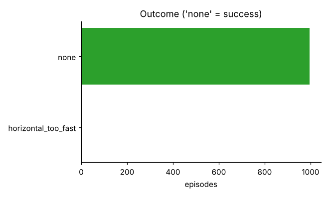

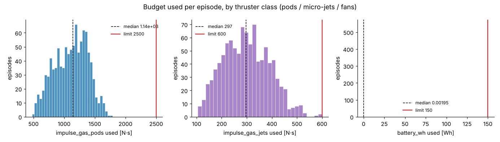

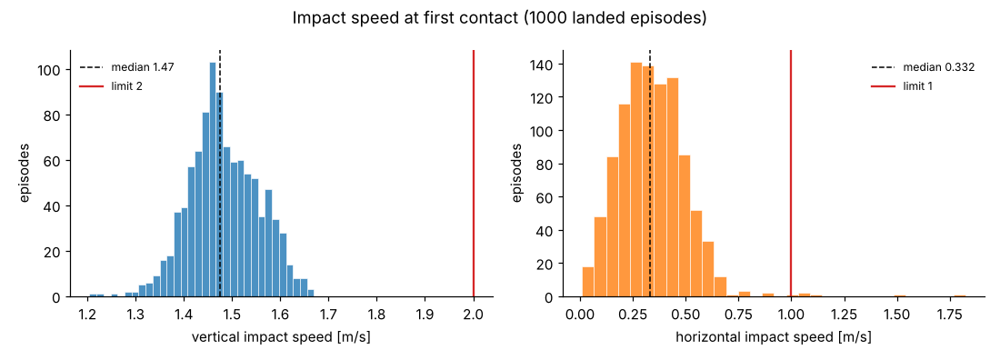

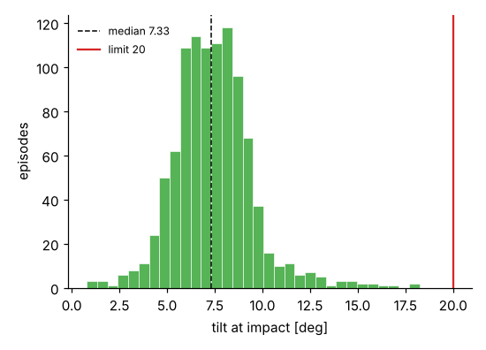

### T1 drop — residual PPO (1000 episodes, seeds 0–999)

| metric | value |
|---|---|
| safe landing | 99.4 % [98.7, 99.7] (994/1000) |
| bad contact (head/torso/pelvis first) | 0.0 % [0.0, 0.4] (0/1000) |
| airbags deployed | 0.3 % [0.1, 0.9] (3/1000) |
| \|vz\| at impact mean / p95 / max [m/s] | 1.74 / 1.91 / 2.62 |
| \|vh\| at impact mean / p95 / max [m/s] | 0.33 / 0.60 / 2.48 |
| tilt at impact mean / p95 / max [deg] | 6.9 / 9.8 / 23.7 |


**Failures (6)** — primary label and episode parameters:

| seed | mode | drop h [m] | tilt [deg] | \|ω\| [rad/s] | \|vz\| [m/s] | \|vh\| [m/s] | tilt@impact [deg] | mass × |
|---|---|---|---|---|---|---|---|---|
| 88 | tilt | 4.645 | 25.916 | 2.535 | 1.707 | 0.460 | 23.679 | 1.088 |
| 140 | horizontal_too_fast | 1.010 | 24.037 | 2.148 | 1.708 | 1.072 | 13.318 | 0.940 |
| 307 | horizontal_too_fast | 1.572 | 25.380 | 2.400 | 1.853 | 1.146 | 12.392 | 1.070 |
| 366 | horizontal_too_fast | 1.278 | 22.679 | 3.242 | 1.389 | 1.375 | 17.660 | 0.950 |
| 559 | horizontal_too_fast | 1.262 | 19.424 | 2.033 | 1.602 | 1.029 | 12.836 | 1.013 |
| 726 | vertical_too_fast | 1.523 | 26.390 | 2.834 | 2.619 | 2.477 | 11.364 | 0.907 |


**Success by drop height / initial tilt / spin rate**

| drop_height | n | success | 95 % CI |
|---|---|---|---|
| 1–1.5 | 132 | 97.7 % | [93.5, 99.2] |
| 1.5–2 | 126 | 98.4 % | [94.4, 99.6] |
| 2–3 | 217 | 100.0 % | [98.3, 100.0] |
| 3–4 | 263 | 100.0 % | [98.6, 100.0] |
| 4–5 | 262 | 99.6 % | [97.9, 99.9] |


| tilt_deg | n | success | 95 % CI |
|---|---|---|---|
| 0–10 | 353 | 100.0 % | [98.9, 100.0] |
| 10–20 | 323 | 99.7 % | [98.3, 99.9] |
| 20–25 | 186 | 98.9 % | [96.2, 99.7] |
| 25–30 | 138 | 97.8 % | [93.8, 99.3] |


| angvel | n | success | 95 % CI |
|---|---|---|---|
| 0–1 | 46 | 100.0 % | [92.3, 100.0] |
| 1–1.5 | 163 | 100.0 % | [97.7, 100.0] |
| 1.5–2 | 316 | 100.0 % | [98.8, 100.0] |
| 2–2.5 | 319 | 99.1 % | [97.3, 99.7] |
| 2.5–3.5 | 156 | 98.1 % | [94.5, 99.3] |


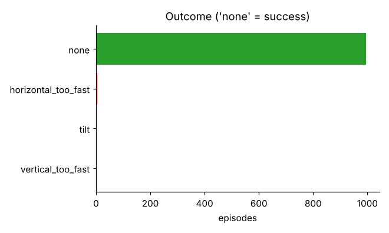

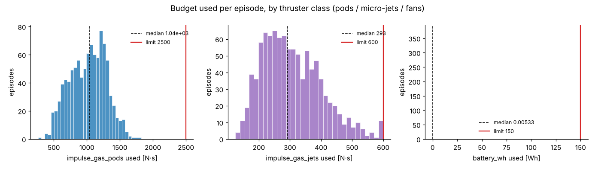

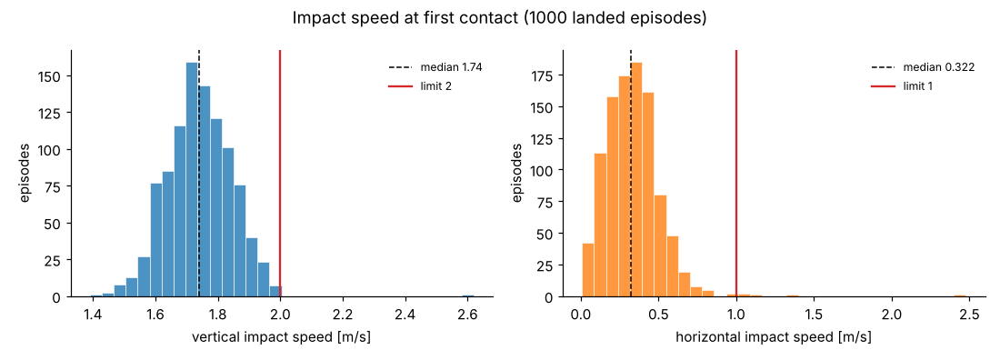

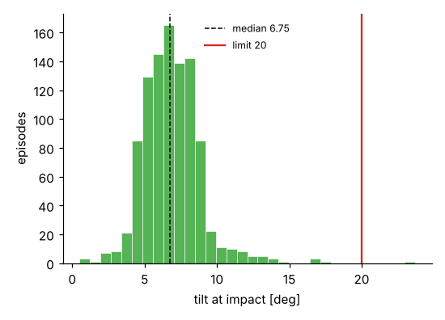


**Failure analysis.** Every *baseline* T1 failure is a horizontal impact speed above 1 m/s;
vertical speed and tilt stay inside the limits in all 1000 episodes, a foot always touches
first and the baseline never deployed an airbag. The residual policy fails on 4 of the same
kind (seeds 307, 366 shared with the baseline, plus 140, 559), one hard landing (seed 726,
which the baseline also fails, here |vz| 2.6 m/s) and one tilt failure from a 4.6 m drop
(seed 88, 23.7° at impact); it deployed airbags in 3 episodes (88, 559, 726 — all failures).
The baseline failures concentrate in short drops (≈1–1.7 m)
with large initial tilt and spin: the body has ~0.5 s of fall, the attitude loop spends it
righting the thrust axis, and the horizontal velocity created by the tilted braking thrust
cannot be damped before touchdown — horizontal damping is only available by tilting the
thrust axis (≤10°), and the jets' direct lateral authority is small (2 side jets per
direction at 40 N). Drops above 2 m are 100 % for the baseline (one residual tilt failure at 4.6 m).

## 4. Baseline vs residual PPO (T1)

Same 1000 seeds (identical initial states and randomisation draws), so the differences are paired.

| quantity | baseline | residual | paired diff (95 % CI) | relative |
|---|---|---|---|---|
| safe landing | 99.5 % [98.8, 99.8] (995/1000) | 99.4 % [98.7, 99.7] (994/1000) |  |  |
| total gas [N·s] | 1410 | 1322 | -88.62 ± 3.04 | -6.3 % |
| pod gas [N·s] | 1112 | 1015 | -97.01 ± 2.35 | -8.7 % |
| jet gas [N·s] | 298 | 307 | +8.40 ± 2.59 | +2.8 % |
| fan battery [Wh] | 0.0109 | 0.0114 | +0.000493 ± 0.000681 | +4.5 % |
| \|vz\| at impact [m/s] | 1.48 | 1.74 | +0.258 ± 0.00479 | +17.4 % |
| \|vh\| at impact [m/s] | 0.34 | 0.332 | -0.00764 ± 0.00604 | -2.2 % |
| tilt at impact [deg] | 7.42 | 6.87 | -0.554 ± 0.0677 | -7.5 % |


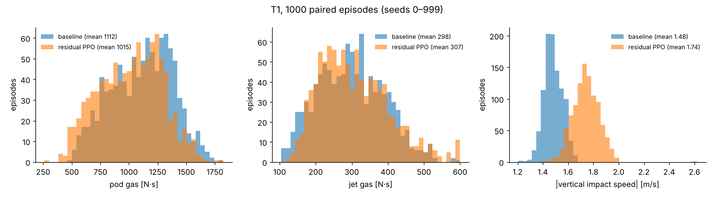


**Training.** `ppo_t1_b` (4 envs, log σ₀ = −1.2) ran 450k steps; `ppo_t1_c` continued from its
400k checkpoint for another 450k steps; the selected policy is the best periodic evaluation
of `ppo_t1_c` (850k steps, `results/policies/residual_t1/model.zip` + `vecnormalize.pkl`).
Periodic evaluations use 50 held-out episodes (seeds ≥ 100000); the baseline on those same
episodes is shown dotted. The curve is still falling at the end (≈ −5 % total gas vs
baseline on the eval seeds) — far from converged: the spec budget is 20 M steps, which at
the measured 130–152 steps/s on this 4-core container is **37–43 h** (≈ 9–11 h on 16 cores
with linear scaling). The residual policy trades margin for gas: it brakes later and lands
faster (mean |vz| up ~0.25 m/s, p95 still below 2 m/s), and its 1000-episode success is
statistically indistinguishable from the baseline.

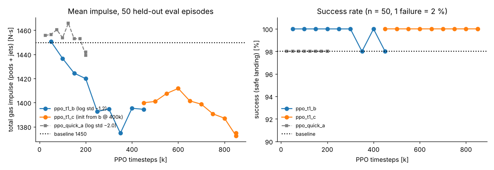

## 5. T2 — boosted jump onto a 2.5 m platform

| metric | value |
|---|---|
| success (foot on top, safe, stayed) | 100.0 % [98.1, 100.0] (200/200) |
| pods mean / p95 / max [N·s] (cap 2500) | 1130 / 1198 / 1221 |
| jets mean / p95 / max [N·s] (cap 600) | 482 / 560 / 600 |
| \|vz\| at platform contact mean / max [m/s] | 1.09 / 1.29 |
| \|vh\| at platform contact mean / max [m/s] | 0.21 / 0.46 |


| platform_distance | n | success | 95 % CI |
|---|---|---|---|
| 1.3–1.4 | 48 | 100.0 % | [92.6, 100.0] |
| 1.4–1.5 | 40 | 100.0 % | [91.2, 100.0] |
| 1.5–1.6 | 61 | 100.0 % | [94.1, 100.0] |
| 1.6–1.7 | 51 | 100.0 % | [93.0, 100.0] |


Jet gas is the T2 bottleneck: 1 episode(s) exhausted the 600 N·s jet tank (and still succeeded — the pods carry attitude through the allocator once the jets are empty). Pods use under half their tank.

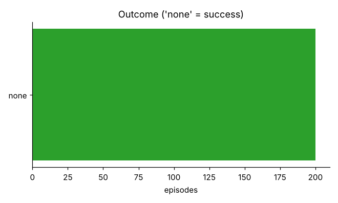

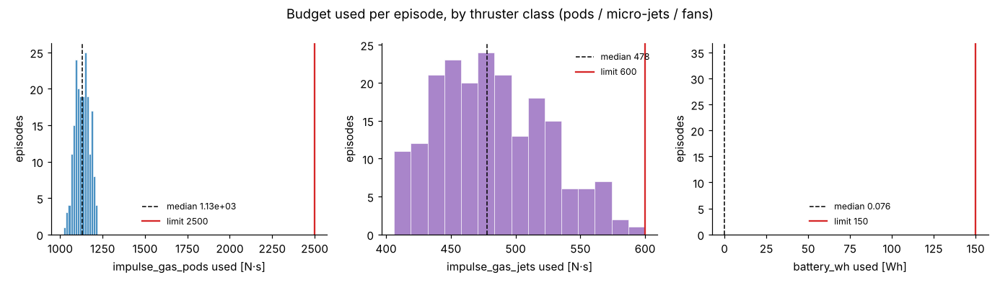

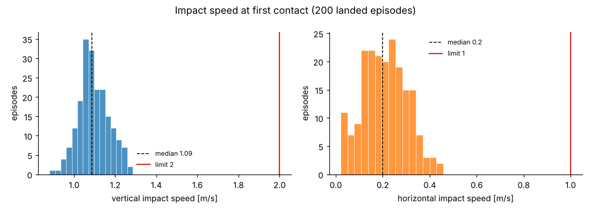

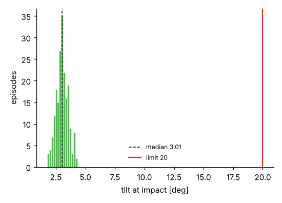

## 6. T3 — push recovery on a 0.3 m beam


The wearer stands on a 0.3 m wide, 1 m high beam and receives a horizontal push on the torso
(200 N for 0.2 s = 40 N·s, uniformly random direction and onset 0.5–1.5 s); success = both
feet still on the beam, pelvis high and torso tilt < 30° at the end of 4 s. Stress tests
re-run the same controller with `--set task.push_force=400|500` (80 / 100 N·s). The side-jet
variant (`configs/task_push_side_jets.yaml` = task_push + the 4 jets of
`configs/suit_variant_side_jets.yaml`, 48 thrusters) runs the same controller unchanged — the
allocator picks up the extra columns automatically.

| evaluation | episodes | stayed on beam | jets mean [N·s] | jets p95 / max | pods mean [N·s] | within budgets |
|---|---|---|---|---|---|---|
| T3 push 200 N — baseline | 200 | 100.0 % [98.1, 100.0] (200/200) | 81 | 168 / 222 | 0 | 100 % |
| T3 push 200 N — side-jet suit | 200 | 100.0 % [98.1, 100.0] (200/200) | 55 | 74 / 163 | 0 | 100 % |
| T3 stress 400 N — default suit | 100 | 88.0 % [80.2, 93.0] (88/100) | 373 | 600 / 600 | 143 | 100 % |
| T3 stress 400 N — side-jet suit | 100 | 100.0 % [96.3, 100.0] (100/100) | 220 | 361 / 402 | 25 | 100 % |
| T3 stress 500 N — default suit | 100 | 51.0 % [41.3, 60.6] (51/100) | 444 | 600 / 600 | 172 | 100 % |
| T3 stress 500 N — side-jet suit | 100 | 90.0 % [82.6, 94.5] (90/100) | 347 | 600 / 600 | 80 | 100 % |


At the nominal 200 N the side jets change jet gas by -32.1 % (-26.1 ± 5.0 N·s paired over 200 seeds).


**Success by push direction** (degrees off the sagittal axis; 90° = pure sideways push, across the beam):

*T3 push 200 N — baseline*

| push_lateral_deg | n | success | 95 % CI |
|---|---|---|---|
| 0–15 | 29 | 100.0 % | [88.3, 100.0] |
| 15–30 | 32 | 100.0 % | [89.3, 100.0] |
| 30–45 | 28 | 100.0 % | [87.9, 100.0] |
| 45–60 | 32 | 100.0 % | [89.3, 100.0] |
| 60–75 | 38 | 100.0 % | [90.8, 100.0] |
| 75–90 | 41 | 100.0 % | [91.4, 100.0] |


*T3 stress 500 N — default suit*

| push_lateral_deg | n | success | 95 % CI |
|---|---|---|---|
| 0–15 | 19 | 100.0 % | [83.2, 100.0] |
| 15–30 | 16 | 100.0 % | [80.6, 100.0] |
| 30–45 | 14 | 100.0 % | [78.5, 100.0] |
| 45–60 | 13 | 15.4 % | [4.3, 42.2] |
| 60–75 | 16 | 0.0 % | [0.0, 19.4] |
| 75–90 | 22 | 0.0 % | [0.0, 14.9] |


*T3 stress 500 N — side-jet suit*

| push_lateral_deg | n | success | 95 % CI |
|---|---|---|---|
| 0–15 | 19 | 100.0 % | [83.2, 100.0] |
| 15–30 | 16 | 100.0 % | [80.6, 100.0] |
| 30–45 | 14 | 100.0 % | [78.5, 100.0] |
| 45–60 | 13 | 100.0 % | [77.2, 100.0] |
| 60–75 | 16 | 68.8 % | [44.4, 85.8] |
| 75–90 | 22 | 77.3 % | [56.6, 89.9] |


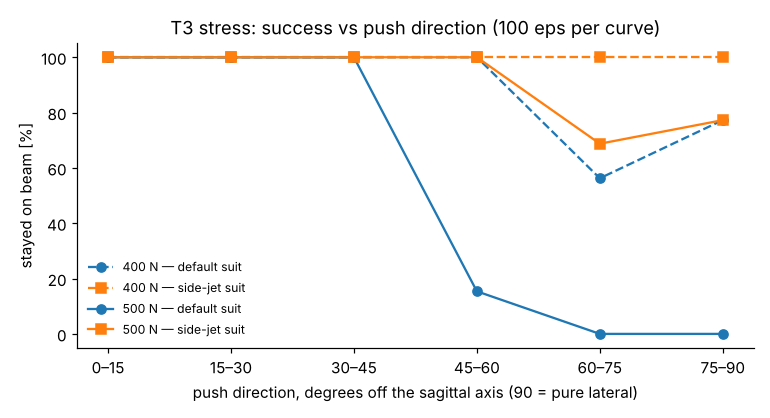

500 N default-suit failures: 49, push direction 71° off sagittal on average; jet gas used 600 N·s mean (max 600).


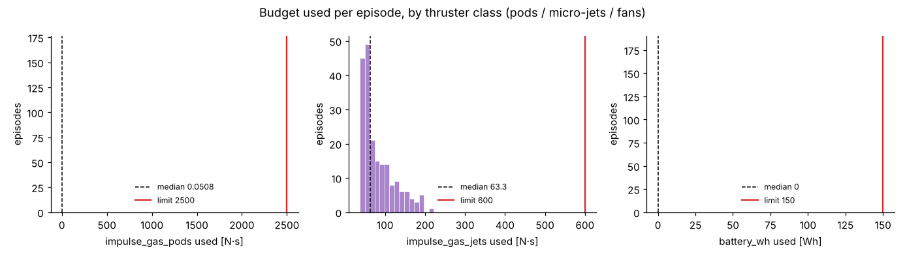

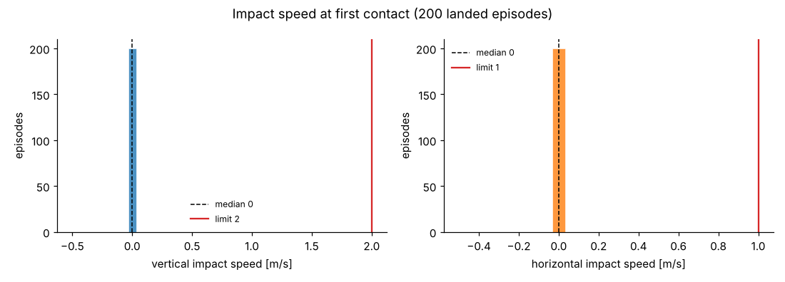

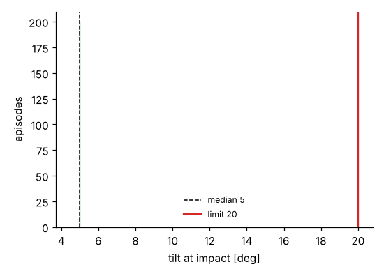

## 7. T4 — budgets

Budgets: pod gas 2500 N·s (both pods share one tank), jet gas 600 N·s (all micro-jets), fan battery 150 Wh. Usage per episode (mean / p95 / max) and the fraction of episodes that stayed within every budget:

| evaluation | n | pods [N·s] | jets [N·s] | fans [Wh] | max jets frac | jet tank emptied | within all |
|---|---|---|---|---|---|---|---|
| T1 drop — baseline | 1000 | 1112 / 1515 / 1789 | 298 / 451 / 600 | 0.01 / 0.05 / 0.09 | 100 % | 1 | 100.0 % [99.6, 100.0] (1000/1000) |
| T1 drop — residual PPO | 1000 | 1015 / 1438 / 1823 | 307 / 486 / 600 | 0.01 / 0.04 / 0.10 | 100 % | 10 | 100.0 % [99.6, 100.0] (1000/1000) |
| T2 boosted jump — baseline | 200 | 1130 / 1198 / 1221 | 482 / 560 / 600 | 0.08 / 0.09 / 0.10 | 100 % | 1 | 100.0 % [98.1, 100.0] (200/200) |
| T3 push 200 N — baseline | 200 | 0 / 1 / 6 | 81 / 168 / 222 | 0.00 / 0.00 / 0.00 | 37 % | 0 | 100.0 % [98.1, 100.0] (200/200) |
| T3 push 200 N — side-jet suit | 200 | 0 / 1 / 2 | 55 / 74 / 163 | 0.00 / 0.00 / 0.00 | 27 % | 0 | 100.0 % [98.1, 100.0] (200/200) |
| T3 stress 500 N — default suit | 100 | 172 / 463 / 862 | 444 / 600 / 600 | 0.01 / 0.08 / 0.27 | 100 % | 52 | 100.0 % [96.3, 100.0] (100/100) |
| T3 stress 500 N — side-jet suit | 100 | 80 / 206 / 481 | 347 / 600 / 600 | 0.00 / 0.00 / 0.00 | 100 % | 7 | 100.0 % [96.3, 100.0] (100/100) |
| T1 drop — side-jet suit (200 eps) | 200 | 1106 / 1451 / 1650 | 281 / 437 / 542 | 0.01 / 0.06 / 0.10 | 90 % | 0 | 100.0 % [98.1, 100.0] (200/200) |
| T1 drop — pods 3.6 cm forward (200 eps) | 200 | 1064 / 1398 / 1609 | 276 / 421 / 479 | 0.05 / 0.11 / 0.18 | 80 % | 0 | 100.0 % [98.1, 100.0] (200/200) |


No evaluated episode overdrew a budget (the thruster bank clips at an empty tank, so "within"
means the controller never ran a tank dry before the end of the episode; a tank that hits
exactly 0 is counted as within but is flagged by the "max jets frac" column). Pods are far
from their limit in every task (T1 p95 ≈ 60 %), the fans use a negligible fraction of the
battery, and **jet gas is the binding resource**: T2 averages ~80 % of the jet tank and T3
pushes above ~400 N empty it. The jets spend a large part of their gas cancelling the pod
pitch moment (pods 3.6 cm behind the CoM) — see section 9.2. Note that the residual policy
empties the jet tank in 1 % of T1 episodes (10/1000, vs 1/1000 for the baseline): it moves
work from the pods to the jets, which is cheap in total impulse but eats the small reserve.

*T1 drop — baseline*


*T2 boosted jump — baseline*


*T3 push 200 N — baseline*


## 8. Failure-case and best-case videos


Each evaluation re-simulates its 5 worst and 5 best episodes (ranked by success, then a
badness score: impact speeds and tilt relative to the limits for landing tasks; final tilt,
lateral CoM offset and jet gas for push recovery) and renders them headless at 640×480, real
time. Each worst #0 clip also has a time-series PNG (height, speeds, tilt, thrust by class,
budgets). Videos are in `videos/<evaluation>/`.

### T1 drop — baseline

| clip | seed | outcome | details |
|---|---|---|---|
| [worst #0](videos/t1_baseline/worst_0_seed726.mp4) | 726 | **fail: horizontal_too_fast** | h 1.52 m, tilt 26°, spin 2.83 rad/s; vz 1.43, vh 1.83 m/s, tilt@impact 15.0° |
| [worst #1](videos/t1_baseline/worst_1_seed366.mp4) | 366 | **fail: horizontal_too_fast** | h 1.28 m, tilt 23°, spin 3.24 rad/s; vz 1.25, vh 1.51 m/s, tilt@impact 17.9° |
| [worst #2](videos/t1_baseline/worst_2_seed180.mp4) | 180 | **fail: horizontal_too_fast** | h 1.01 m, tilt 27°, spin 2.59 rad/s; vz 1.28, vh 1.05 m/s, tilt@impact 18.2° |
| [worst #3](videos/t1_baseline/worst_3_seed307.mp4) | 307 | **fail: horizontal_too_fast** | h 1.57 m, tilt 25°, spin 2.40 rad/s; vz 1.46, vh 1.07 m/s, tilt@impact 14.4° |
| [worst #4](videos/t1_baseline/worst_4_seed72.mp4) | 72 | **fail: horizontal_too_fast** | h 1.65 m, tilt 27°, spin 2.48 rad/s; vz 1.52, vh 1.12 m/s, tilt@impact 9.3° |
| [best #0](videos/t1_baseline/best_0_seed983.mp4) | 983 | success | h 1.30 m, tilt 16°, spin 2.26 rad/s; vz 1.32, vh 0.06 m/s, tilt@impact 1.3° |
| [best #1](videos/t1_baseline/best_1_seed147.mp4) | 147 | success | h 1.92 m, tilt 8°, spin 2.43 rad/s; vz 1.45, vh 0.10 m/s, tilt@impact 1.1° |
| [best #2](videos/t1_baseline/best_2_seed309.mp4) | 309 | success | h 1.38 m, tilt 1°, spin 2.13 rad/s; vz 1.44, vh 0.09 m/s, tilt@impact 2.8° |
| [best #3](videos/t1_baseline/best_3_seed63.mp4) | 63 | success | h 1.48 m, tilt 8°, spin 1.98 rad/s; vz 1.42, vh 0.19 m/s, tilt@impact 1.7° |
| [best #4](videos/t1_baseline/best_4_seed615.mp4) | 615 | success | h 1.25 m, tilt 4°, spin 2.33 rad/s; vz 1.51, vh 0.16 m/s, tilt@impact 2.0° |

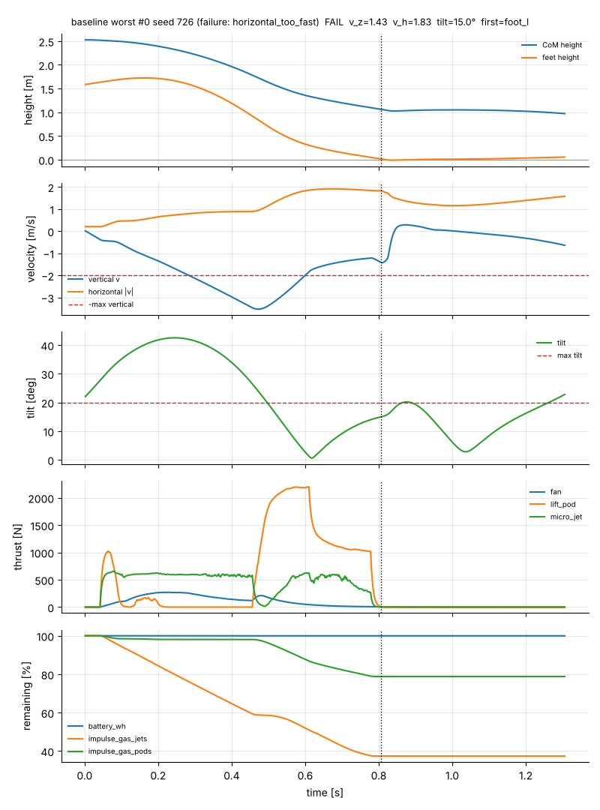

### T1 drop — residual PPO

| clip | seed | outcome | details |
|---|---|---|---|
| [worst #0](videos/t1_residual/worst_0_seed726.mp4) | 726 | **fail: vertical_too_fast** | h 1.52 m, tilt 26°, spin 2.83 rad/s; vz 2.62, vh 2.48 m/s, tilt@impact 11.4° |
| [worst #1](videos/t1_residual/worst_1_seed366.mp4) | 366 | **fail: horizontal_too_fast** | h 1.28 m, tilt 23°, spin 3.24 rad/s; vz 1.39, vh 1.37 m/s, tilt@impact 17.7° |
| [worst #2](videos/t1_residual/worst_2_seed307.mp4) | 307 | **fail: horizontal_too_fast** | h 1.57 m, tilt 25°, spin 2.40 rad/s; vz 1.85, vh 1.15 m/s, tilt@impact 12.4° |
| [worst #3](videos/t1_residual/worst_3_seed140.mp4) | 140 | **fail: horizontal_too_fast** | h 1.01 m, tilt 24°, spin 2.15 rad/s; vz 1.71, vh 1.07 m/s, tilt@impact 13.3° |
| [worst #4](videos/t1_residual/worst_4_seed88.mp4) | 88 | **fail: tilt** | h 4.64 m, tilt 26°, spin 2.53 rad/s; vz 1.71, vh 0.46 m/s, tilt@impact 23.7° |
| [best #0](videos/t1_residual/best_0_seed983.mp4) | 983 | success | h 1.30 m, tilt 16°, spin 2.26 rad/s; vz 1.49, vh 0.15 m/s, tilt@impact 2.6° |
| [best #1](videos/t1_residual/best_1_seed979.mp4) | 979 | success | h 1.08 m, tilt 3°, spin 1.35 rad/s; vz 1.72, vh 0.01 m/s, tilt@impact 4.1° |
| [best #2](videos/t1_residual/best_2_seed823.mp4) | 823 | success | h 1.75 m, tilt 19°, spin 1.32 rad/s; vz 1.90, vh 0.03 m/s, tilt@impact 2.2° |
| [best #3](videos/t1_residual/best_3_seed603.mp4) | 603 | success | h 1.56 m, tilt 23°, spin 2.18 rad/s; vz 1.51, vh 0.26 m/s, tilt@impact 1.6° |
| [best #4](videos/t1_residual/best_4_seed606.mp4) | 606 | success | h 3.16 m, tilt 28°, spin 2.67 rad/s; vz 1.86, vh 0.07 m/s, tilt@impact 2.2° |

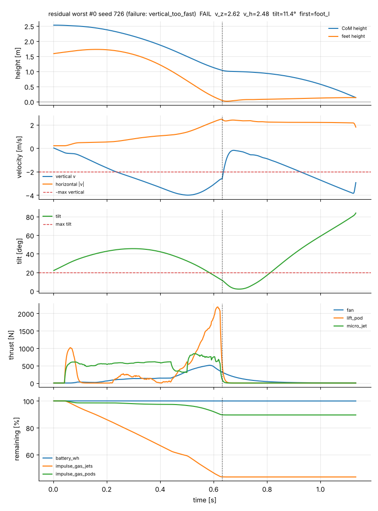

### T2 boosted jump — baseline

| clip | seed | outcome | details |
|---|---|---|---|
| [worst #0](videos/t2_jump/worst_0_seed75.mp4) | 75 | success | vz 1.25, vh 0.37 m/s; pods 1220, jets 571 N·s |
| [worst #1](videos/t2_jump/worst_1_seed117.mp4) | 117 | success | vz 1.16, vh 0.46 m/s; pods 1169, jets 528 N·s |
| [worst #2](videos/t2_jump/worst_2_seed61.mp4) | 61 | success | vz 1.19, vh 0.41 m/s; pods 1178, jets 505 N·s |
| [worst #3](videos/t2_jump/worst_3_seed136.mp4) | 136 | success | vz 1.29, vh 0.31 m/s; pods 1202, jets 462 N·s |
| [worst #4](videos/t2_jump/worst_4_seed83.mp4) | 83 | success | vz 1.09, vh 0.42 m/s; pods 1126, jets 488 N·s |
| [best #0](videos/t2_jump/best_0_seed94.mp4) | 94 | success | vz 1.08, vh 0.02 m/s; pods 1092, jets 423 N·s |
| [best #1](videos/t2_jump/best_1_seed51.mp4) | 51 | success | vz 1.11, vh 0.02 m/s; pods 1076, jets 436 N·s |
| [best #2](videos/t2_jump/best_2_seed59.mp4) | 59 | success | vz 1.05, vh 0.04 m/s; pods 1117, jets 409 N·s |
| [best #3](videos/t2_jump/best_3_seed134.mp4) | 134 | success | vz 1.05, vh 0.04 m/s; pods 1138, jets 432 N·s |
| [best #4](videos/t2_jump/best_4_seed160.mp4) | 160 | success | vz 1.02, vh 0.05 m/s; pods 1088, jets 436 N·s |

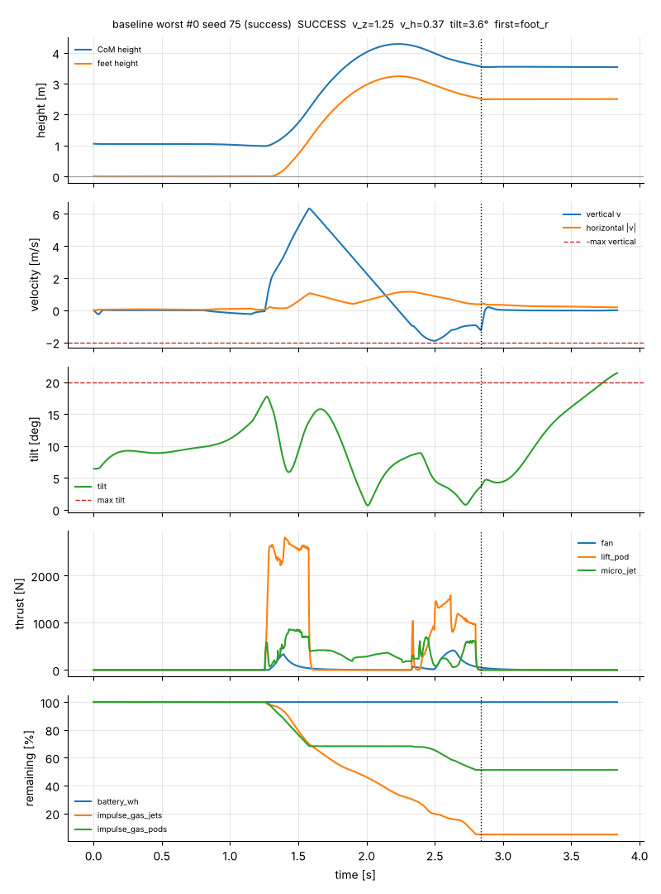

### T3 push 200 N — baseline

| clip | seed | outcome | details |
|---|---|---|---|
| [worst #0](videos/t3_push/worst_0_seed140.mp4) | 140 | success | 200 N at 288° (72° off sagittal); final tilt 10.7°, jets 222 N·s |
| [worst #1](videos/t3_push/worst_1_seed177.mp4) | 177 | success | 200 N at 259° (79° off sagittal); final tilt 10.2°, jets 97 N·s |
| [worst #2](videos/t3_push/worst_2_seed95.mp4) | 95 | success | 200 N at 98° (82° off sagittal); final tilt 10.2°, jets 104 N·s |
| [worst #3](videos/t3_push/worst_3_seed83.mp4) | 83 | success | 200 N at 112° (68° off sagittal); final tilt 12.2°, jets 71 N·s |
| [worst #4](videos/t3_push/worst_4_seed114.mp4) | 114 | success | 200 N at 269° (89° off sagittal); final tilt 9.2°, jets 134 N·s |
| [best #0](videos/t3_push/best_0_seed36.mp4) | 36 | success | 200 N at 185° (5° off sagittal); final tilt 6.1°, jets 43 N·s |
| [best #1](videos/t3_push/best_1_seed51.mp4) | 51 | success | 200 N at 156° (24° off sagittal); final tilt 6.4°, jets 37 N·s |
| [best #2](videos/t3_push/best_2_seed81.mp4) | 81 | success | 200 N at 154° (26° off sagittal); final tilt 6.4°, jets 37 N·s |
| [best #3](videos/t3_push/best_3_seed184.mp4) | 184 | success | 200 N at 194° (14° off sagittal); final tilt 6.7°, jets 39 N·s |
| [best #4](videos/t3_push/best_4_seed29.mp4) | 29 | success | 200 N at 190° (10° off sagittal); final tilt 7.0°, jets 40 N·s |

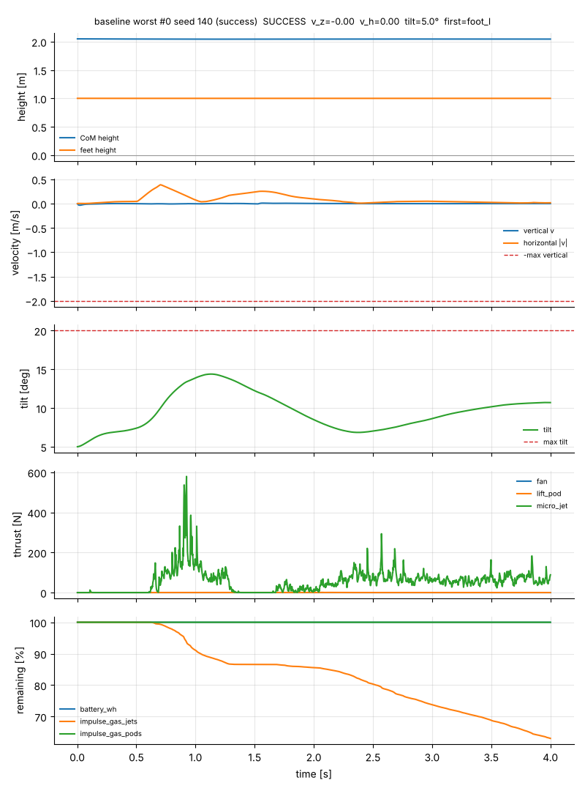

### T3 push 200 N — side-jet suit

| clip | seed | outcome | details |
|---|---|---|---|
| [worst #0](videos/t3_push_side_jets/worst_0_seed140.mp4) | 140 | success | 200 N at 288° (72° off sagittal); final tilt 10.6°, jets 163 N·s |
| [worst #1](videos/t3_push_side_jets/worst_1_seed128.mp4) | 128 | success | 200 N at 281° (79° off sagittal); final tilt 8.7°, jets 126 N·s |
| [worst #2](videos/t3_push_side_jets/worst_2_seed20.mp4) | 20 | success | 200 N at 288° (72° off sagittal); final tilt 8.7°, jets 116 N·s |
| [worst #3](videos/t3_push_side_jets/worst_3_seed113.mp4) | 113 | success | 200 N at 288° (72° off sagittal); final tilt 8.1°, jets 107 N·s |
| [worst #4](videos/t3_push_side_jets/worst_4_seed83.mp4) | 83 | success | 200 N at 112° (68° off sagittal); final tilt 12.2°, jets 44 N·s |
| [best #0](videos/t3_push_side_jets/best_0_seed36.mp4) | 36 | success | 200 N at 185° (5° off sagittal); final tilt 6.2°, jets 44 N·s |
| [best #1](videos/t3_push_side_jets/best_1_seed51.mp4) | 51 | success | 200 N at 156° (24° off sagittal); final tilt 6.4°, jets 37 N·s |
| [best #2](videos/t3_push_side_jets/best_2_seed81.mp4) | 81 | success | 200 N at 154° (26° off sagittal); final tilt 6.5°, jets 38 N·s |
| [best #3](videos/t3_push_side_jets/best_3_seed184.mp4) | 184 | success | 200 N at 194° (14° off sagittal); final tilt 6.8°, jets 42 N·s |
| [best #4](videos/t3_push_side_jets/best_4_seed153.mp4) | 153 | success | 200 N at 199° (19° off sagittal); final tilt 6.9°, jets 40 N·s |

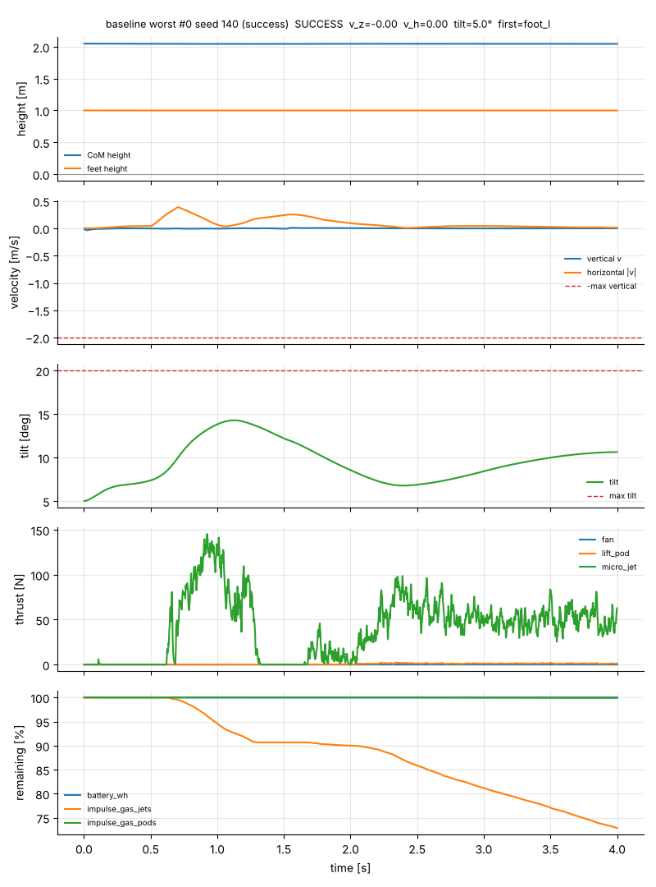

### T3 stress 500 N — default suit

| clip | seed | outcome | details |
|---|---|---|---|
| [worst #0](videos/t3_500N_default/worst_0_seed92.mp4) | 92 | **fail: other** | 500 N at 58° (58° off sagittal); final tilt 64.7°, jets 600 N·s |
| [worst #1](videos/t3_500N_default/worst_1_seed96.mp4) | 96 | **fail: other** | 500 N at 82° (82° off sagittal); final tilt 65.0°, jets 600 N·s |
| [worst #2](videos/t3_500N_default/worst_2_seed82.mp4) | 82 | **fail: other** | 500 N at 94° (86° off sagittal); final tilt 65.7°, jets 600 N·s |
| [worst #3](videos/t3_500N_default/worst_3_seed91.mp4) | 91 | **fail: other** | 500 N at 246° (66° off sagittal); final tilt 65.3°, jets 600 N·s |
| [worst #4](videos/t3_500N_default/worst_4_seed95.mp4) | 95 | **fail: other** | 500 N at 98° (82° off sagittal); final tilt 65.1°, jets 600 N·s |
| [best #0](videos/t3_500N_default/best_0_seed7.mp4) | 7 | success | 500 N at 190° (10° off sagittal); final tilt 6.9°, jets 144 N·s |
| [best #1](videos/t3_500N_default/best_1_seed36.mp4) | 36 | success | 500 N at 185° (5° off sagittal); final tilt 6.4°, jets 159 N·s |
| [best #2](videos/t3_500N_default/best_2_seed71.mp4) | 71 | success | 500 N at 181° (1° off sagittal); final tilt 7.9°, jets 145 N·s |
| [best #3](videos/t3_500N_default/best_3_seed0.mp4) | 0 | success | 500 N at 189° (9° off sagittal); final tilt 7.5°, jets 142 N·s |
| [best #4](videos/t3_500N_default/best_4_seed29.mp4) | 29 | success | 500 N at 190° (10° off sagittal); final tilt 7.9°, jets 149 N·s |

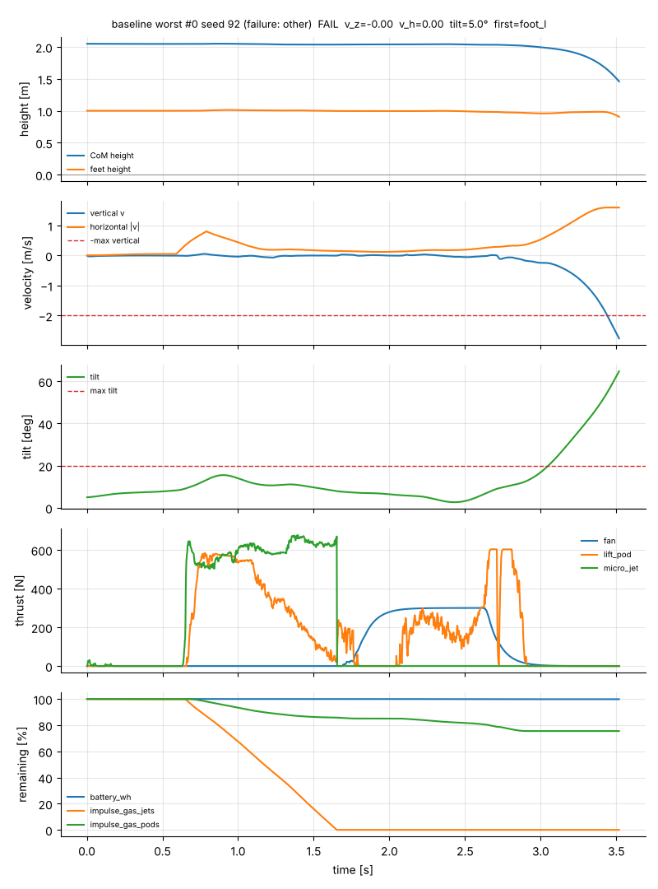

### T3 stress 500 N — side-jet suit

| clip | seed | outcome | details |
|---|---|---|---|
| [worst #0](videos/t3_500N_side_jets/worst_0_seed82.mp4) | 82 | **fail: other** | 500 N at 94° (86° off sagittal); final tilt 11.0°, jets 600 N·s |
| [worst #1](videos/t3_500N_side_jets/worst_1_seed1.mp4) | 1 | **fail: other** | 500 N at 282° (78° off sagittal); final tilt 7.5°, jets 581 N·s |
| [worst #2](videos/t3_500N_side_jets/worst_2_seed73.mp4) | 73 | **fail: other** | 500 N at 269° (89° off sagittal); final tilt 8.7°, jets 564 N·s |
| [worst #3](videos/t3_500N_side_jets/worst_3_seed35.mp4) | 35 | **fail: other** | 500 N at 71° (71° off sagittal); final tilt 8.0°, jets 484 N·s |
| [worst #4](videos/t3_500N_side_jets/worst_4_seed20.mp4) | 20 | **fail: other** | 500 N at 288° (72° off sagittal); final tilt 9.3°, jets 467 N·s |
| [best #0](videos/t3_500N_side_jets/best_0_seed8.mp4) | 8 | success | 500 N at 160° (20° off sagittal); final tilt 7.1°, jets 159 N·s |
| [best #1](videos/t3_500N_side_jets/best_1_seed7.mp4) | 7 | success | 500 N at 190° (10° off sagittal); final tilt 7.0°, jets 148 N·s |
| [best #2](videos/t3_500N_side_jets/best_2_seed71.mp4) | 71 | success | 500 N at 181° (1° off sagittal); final tilt 7.8°, jets 152 N·s |
| [best #3](videos/t3_500N_side_jets/best_3_seed43.mp4) | 43 | success | 500 N at 197° (17° off sagittal); final tilt 6.4°, jets 161 N·s |
| [best #4](videos/t3_500N_side_jets/best_4_seed0.mp4) | 0 | success | 500 N at 189° (9° off sagittal); final tilt 7.4°, jets 145 N·s |

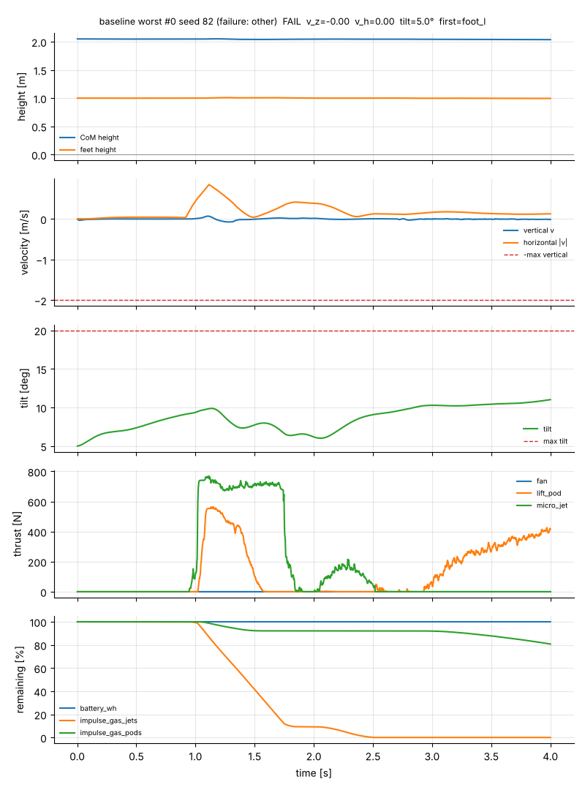

## 9. Recommended thruster count / placement changes


Two cheap changes to the default layout, each tested with the *unchanged* baseline
controllers (the allocator adapts to the thruster set from the YAML).

### 9.1 Add lateral micro-jets (configs/suit_variant_side_jets.yaml)

| case | default suit | +4 side jets | jet gas default → variant [N·s] |
|---|---|---|---|
| T3 200 N | 100.0 % [98.1, 100.0] (200/200) | 100.0 % [98.1, 100.0] (200/200) | 81 → 55 |
| T3 400 N | 88.0 % [80.2, 93.0] (88/100) | 100.0 % [96.3, 100.0] (100/100) | 373 → 220 |
| T3 500 N | 51.0 % [41.3, 60.6] (51/100) | 90.0 % [82.6, 94.5] (90/100) | 444 → 347 |
| T1 drop (200 eps) | 99.0 % [96.4, 99.7] (198/200) | 99.0 % [96.4, 99.7] (198/200) | 304 → 281 |


The default suit has only two lateral jets per direction (upper-back + thigh side jets), so
its sideways authority about the feet is ≈1.25 m/s² versus 4–5 m/s² sagittally. The stress
tests show exactly that: at 500 N the default suit holds every push within 45° of the
sagittal axis but loses almost every push more than 60° off it, and its failures all end
with the jet tank empty (600 N·s). Adding four 40 N lateral jets (one per side at the
shoulders, one per side at the hips, on the existing jet tank) lifts 400 N from 88 % to
100 % and 500 N from 51 % to 90 %, and cuts jet gas by about a third at the nominal 200 N
(81 → 55 N·s), because the push is now cancelled by a direct lateral force rather than by
pod-differential / leveraged jets.

In T1 the side jets reduce jet gas by ≈8 % but do **not** fix the low-drop horizontal-speed
failures (the same seeds 72 and 180 fail, now just above the 1 m/s limit at 1.04 / 1.01 m/s):
those are limited by attitude-recovery time, not lateral thrust — a controller change
(direct jet horizontal damping near the ground, or the residual policy) is needed there.

**Recommendation: add the 4 side jets** (48 thrusters). It costs nothing at nominal loads,
saves jet gas in every task tested and is the largest robustness gain found for T3.

### 9.2 Move the lift pods forward onto the CoM (configs/suit_variant_pods_fwd.yaml)

| quantity | default (seeds 0–199) | pods +3.6 cm fwd | paired diff (95 % CI) | relative |
|---|---|---|---|---|
| safe landing | 99.0 % [96.4, 99.7] (198/200) | 99.5 % [97.2, 99.9] (199/200) |  |  |
| pod gas [N·s] | 1120 | 1064 | -55.79 ± 3.29 | -5.0 % |
| jet gas [N·s] | 304 | 276 | -28.36 ± 3.16 | -9.3 % |
| total gas [N·s] | 1425 | 1340 | -84.16 ± 3.55 | -5.9 % |
| \|vh\| at impact [m/s] | 0.334 | 0.341 | +0.00678 ± 0.00622 | +2.0 % |
| tilt at impact [deg] | 7.60 | 9.17 | +1.57 ± 0.0637 | +20.6 % |


With the thrust line through the CoM the jets no longer cancel a steady pod pitch moment:
jet gas drops ≈9 % and pod gas ≈5 % (the attitude loop also needs less pod-differential
help), ≈ −6 % total — about the same saving as the residual PPO policy, with no learning
and without landing faster. Safety is unchanged within the 200-episode resolution (seed 180,
a 1.0 m drop, still fails on horizontal speed; seed 72 now passes). The one cost is a
slightly larger tilt at impact (+1.6° mean, still far below the 20° limit): the baseline
gains were tuned on the default geometry and lean on the pod pitch moment, so a retune
should recover it.

**Recommendation: mount the pods ≈3.6 cm further forward** (or shift the hip-pod mass
equivalently) so the pod thrust line passes through the whole-body CoM in the landing
posture; the jets then no longer have to hold a steady counter-pitch moment while the pods
brake. Since the CoM moves with posture (and differs between wearers), an adjustable pod
mount (±3 cm) is the practical form of this change.


### 9.3 Summary of layout recommendations

1. **+4 lateral micro-jets** (shoulders and hips, 40 N each) — 48 thrusters; raises lateral
   push tolerance (section 9.1). No change needed elsewhere.
2. **Pods forward onto the CoM** (adjustable mount) — removes the static pitch moment that
   the jets cancel during every braking burn (section 9.2).
3. Jet tank is the binding budget in T2/T3; if mass allows, shift capacity from the pod tank
   (T1 p95 use ≈ 60 % of 2500 N·s) to the jet tank (600 N·s) rather than adding gas overall.

## 10. Limitations and next steps


* **RL budget.** The residual policy saw 850k steps (4 % of the 20 M-step spec). The
  projected 20 M run is 37–43 h on this 4-core box (≈9–11 h on 16 cores). The training curve
  was still improving; the residual is the right place to recover the low-drop horizontal
  failures, but it has not done so yet.
* **Airbag contact accounting.** A deployed airbag touching the ground is attributed to its
  carrier segment (torso / pelvis) and therefore counts as a "bad contact" in the env's
  bookkeeping. The baseline never deployed airbags in any task; the residual policy deployed
  them in 3/1000 T1 episodes (all already failures on speed/tilt, and seed 726 indeed logs
  `any_bad_contact` after the bag hit the ground), so no reported success rate is affected,
  but the airbag path is effectively untested end-to-end and the metric must be fixed (count airbag
  geoms separately) before airbag-dependent scenarios are evaluated.
* **Estimator tilt residual.** In free fall and under thrust the attitude is gyro-only (the
  gravity correction needs quasi-static conditions), so the ±2° initial alignment error and
  gyro noise persist through the drop; standing, the correction leaves ~0.5–1° (postural sway
  read as tilt). This sets a floor on horizontal-velocity accuracy (1° ≈ 0.17 m/s² of
  mis-attributed thrust) and is a plausible contributor to the horizontal-speed failures.
* **EMG** is a config stub (`emg.enabled: false`): no wearer-intent input is modelled; the
  human is a passive servo-held body.
* **No MyoSuite / musculoskeletal model**: joints are torque-limited PD servos, not muscles;
  landing loads on the joints are not evaluated.
* T2 assumes the controller knows the platform position (`jump.mission_knows_platform`).
* T3's beam is static and the push is a pure force on the torso CoM.
* Statistics: T2/T3 at n = 200 give 100 % with a 98.1 % lower Wilson bound; T1 at n = 1000
  resolves ≈ ±0.4 % around 99.5 %.

**Next steps:** (1) 20 M-step residual PPO on 16 cores, with low-drop/high-spin curriculum;
(2) adopt the side-jet + pods-forward layout as the new default and re-run T1–T3;
(3) separate airbag contacts in the bookkeeping and add an airbag-required scenario;
(4) jet-tank sizing study (T2 is the limiting mission); (5) EMG/intent and a musculoskeletal
human (MyoSuite) for joint-load assessment.

## 11. Reproducing this report


```bash
python scripts/evaluate.py --task configs/task_drop.yaml --controller baseline --episodes 1000 --seed 0 --workers 4 --out runs/eval_baseline_t1 --videos 5
python scripts/evaluate.py --task configs/task_drop.yaml --controller residual --policy results/policies/residual_t1/model.zip --episodes 1000 --seed 0 --workers 4 --out runs/eval_residual_t1 --videos 5
python scripts/evaluate.py --task configs/task_jump.yaml --episodes 200 --workers 4 --out runs/eval_t2
python scripts/evaluate.py --task configs/task_push.yaml --episodes 200 --workers 4 --out runs/eval_t3_final
python scripts/evaluate.py --task configs/task_push_side_jets.yaml --episodes 200 --workers 4 --out runs/eval_t3_side_jets
python scripts/evaluate.py --task configs/task_push.yaml --episodes 100 --set task.push_force=500 --workers 4 --out runs/stress_t3_500N_default      # also 400
python scripts/evaluate.py --task configs/task_push_side_jets.yaml --episodes 100 --set task.push_force=500 --workers 4 --out runs/stress_t3_500N_side_jets
python scripts/evaluate.py --task configs/task_drop_side_jets.yaml --episodes 200 --workers 4 --out runs/eval_t1_side_jets
python scripts/evaluate.py --task configs/task_drop_pods_fwd.yaml --episodes 200 --workers 4 --out runs/eval_t1_pods_fwd
python scripts/make_report.py
```
Summaries of every evaluation are copied to `results/m7_*_summary.json`.
